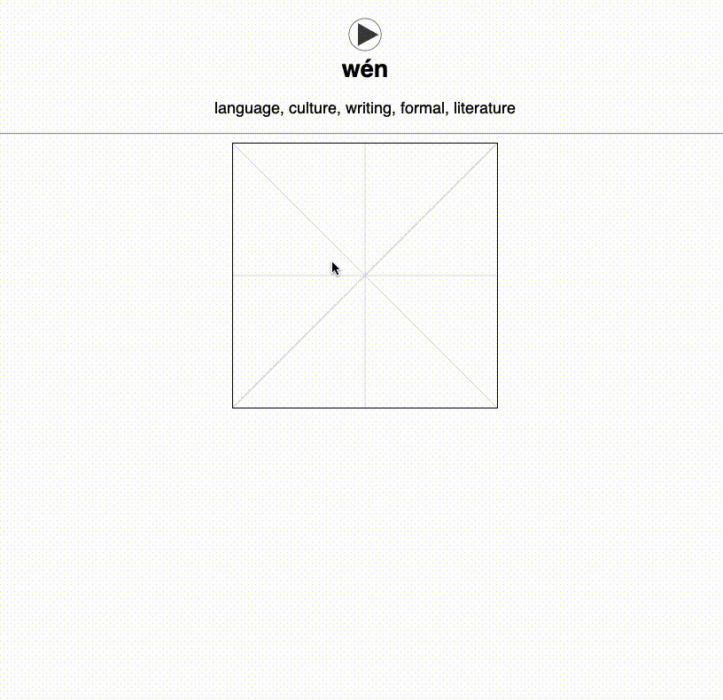
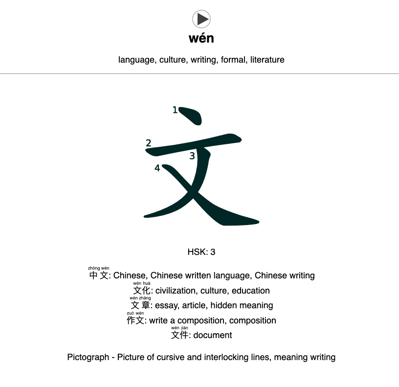

# AnkiChinese

Generate [Anki](https://apps.ankiweb.net/) flashcards from Chinese character data.

<div style="display:flex;">
  <table class="table">
    <tr>
      <td>
        
      </td>
    </tr>
    <tr>
      <td class="caption">Online Flashcard</td>
    </tr>
  </table>

  <table class="table">
    <tr>
      <td>
        
      </td>
    </tr>
    <tr>
      <td class="caption">Offline Flashcard</td>
    </tr>
  </table>
</div>

# Installation

    pip install ankichinese

# Usage

Run `ankichinese-gui` for the graphical interface, or use the commands below.
The GUI requires Tkinter, which is included with most Python installations.

From a source checkout on Windows, you can run the CLI directly:

```powershell
.\.venv\Scripts\python.exe src\AnkiChinese\cli.py -x update
```

Alternatively, install the checkout with `.\.venv\Scripts\python.exe -m pip install -e .`,
then run `ankichinese -x update` or `python -m AnkiChinese.cli -x update`
with the virtual environment activated.

    ankichinese

    -h, --help                          Show help message and exit

    --export, -x {anki, csv, update}    Export mode (default: anki)
                                        anki: Generate new AnkiChinese deck
                                        csv: Generate CSV file
                                        update: Update existing deck
    --input, -i INPUT                   Input file with characters to process (default: input.txt)
    --output, -o OUTPUT                 Name of output file (do not include extension)
                                        (default: ankichinese_output)

    --definitions, -def NUM             Number of definitions to include per character (default: 3)
    --examples, -ex NUM                 Number of example words to include per character (default: 5)

    --audio-downloads-at-once NUM
                                        Maximum uncached audio downloads at once (default: 10)
    --audio-downloads-per-second NUM
                                        Maximum uncached audio downloads per second (default: 5)
    --audio-cache PATH                 Folder for cached audio recordings

## Generate New AnkiChinese Deck

How to create an entirely new Anki deck with the name `ankichinese_output.apkg` in the current directory using custom AnkiChinese styling.

1. Create `input.txt` with the characters you want to process.
2. Run `ankichinese -x anki`.
3. Open Anki and import `ankichinese_output.apkg`.

**Updating is Easy!**  
Just run `ankichinese -x anki` again with new characters in `input.txt` and import the new `ankichinese_output.apkg` file into Anki. Anki will automatically update the existing deck without losing progress.

You can also update the imported deck directly: keep Anki open with AnkiConnect installed, choose **Update** in the GUI or run `ankichinese -x update`, then select the deck and its `AnkiChinese` note type. Matching notes are updated in place, and new Hanzi are added to the deck.

## Update Existing (Non-AnkiChinese) Deck Without Losing Progress

1. Create `input.txt` with the characters you want to process.
2. Install the [AnkiConnect add-on](https://ankiweb.net/shared/info/2055492159) and leave Anki open.
3. Choose **Update** in the GUI, or run `ankichinese -x update` in the CLI.
4. Choose the deck and note type. AnkiChinese updates matching fields below; the note type must include `Hanzi`.

| Field Name  | Description                              |
| ----------- | ---------------------------------------- |
| Hanzi       | Simplified character (**REQUIRED**)      |
| Traditional | Traditional form                         |
| Definition  | Meaning of character                     |
| Pinyin      | Pinyin readings, most common first       |
| Examples    | Example words                            |
| Writing Hints | Example readings and meanings without the written words |
| Formation   | Origin / mnemonic for character          |
| HSK         | HSK character recognition level, when available |
| Frequency Rank | Character rank from the frequency source |
| Frequency Count | Character occurrences per million from the frequency source |
| Audio       | Character pronunciation recording, when available |

5. Choose whether to process the deck's existing Hanzi too, review the update summary, then confirm. Matching notes are updated in place, missing Hanzi are added, and audio is uploaded to Anki.

New AnkiChinese decks use `Writing Hints` for the writing-card prompts. When
updating an existing note type, only matching fields are updated; its fields and
templates are preserved.

## Example word selection

Character definitions use editable short glosses in
`src/AnkiChinese/data/compact_glosses.json`, grouped by character and tone-number
pinyin. The initial set covers 95 common characters and 158 readings, including
particles, grammar words, and characters with several pronunciations. Glosses
group close synonyms and prioritize everyday meanings. Formal, regional, and
classical uses are labeled where needed. Each entry includes the original
CC-CEDICT `source_definitions` for reference.

Edit an entry's `glosses` list to change card wording. For example, 之 has
`["of; 's (formal)", "him/her/it (classical)"]`. Changes are loaded on the next
CLI or GUI generation. The definition limit applies to displayed glosses, with
one gloss per selected reading before additional senses. Characters without a
compact entry use dictionary-order definitions, with archaic and name senses
placed later. Definition selection uses dictionary order and reviewed glosses.
The full source dictionary remains in `src/AnkiChinese/data/cedict_ts.u8`.

Examples first cover useful pronunciations, then fill the remaining slots using
frequency and meaning variety. Counts are normalized per million words within
each corpus before blending. The initial blend uses 50% BCC dialogue, 30% Leiden
Weibo, and 20% BCC news. A written word with several readings supplies shared
frequency evidence.

Tune the frequency cutoffs and selection multipliers at the top of
`src/AnkiChinese/selection.py`. The reading cutoff starts at 0.25 occurrences per
million blended words. Automatic names need at least 2 occurrences per million
in either dialogue or Weibo and receive a frequency penalty. Cards normally contain at most
one name, with exceptions for pronunciation coverage, personal preferences, and
characters primarily used in names. Corpus weights are at the top of
`src/AnkiChinese/sources/frequency.py`. To disable Weibo, set `INTERNET_WEIGHT` to
zero and adjust the dialogue and news weights so all three sum to one.

When a character has no frequent ordinary compound examples, a name can qualify
at 0.25 blended occurrences per million. This supports characters used in names
and geographic abbreviations such as 挝 in 老挝 and 匈 in 匈牙利. The threshold is
`MIN_NEEDED_NAME_FREQUENCY_PER_MILLION` at the top of the selection file.

Short usage phrases for standalone particles, pronouns, and measure words are
editable in `src/AnkiChinese/data/character_usage.json`. Their frequency is
unmeasured. The same file supplies reviewed primary readings for ambiguous
characters such as 吗 and 诶. Character audio uses the standalone dictionary
reading, with contextual neutral-tone pronunciations shown in the examples.

Audio lookup handles source filename variants and falls back to Wikimedia
Commons, caching the recording and its individual attribution and license
notice. These notices accompany CSV and APKG exports. Expected gaps in example
or recording coverage appear as informational messages. Download failures,
unfulfilled explicit preferences, and example limits that prevent pronunciation
coverage are reported as issues.

Leiden Weibo adds a social-media signal from 5.1 million posts written in January
2012. This snapshot reflects the vocabulary and platforms of that period. The
bundled count table retains all 101,431,081 tokens across 1,379,769 word forms.
It is licensed under CC BY-NC-SA 3.0. Exports include its attribution and license
notice. See [the corpus download page](https://leidenweibocorpus.nl/openaccess)
and [license terms](https://leidenweibocorpus.nl/legal).

Edit `src/AnkiChinese/data/selection_preferences.json` to set personal preferences.
For example, the following settings prefer two names, exclude one word, and
explicitly include or exclude character readings.

```json
{
  "preferred_words": [],
  "excluded_words": ["京畿"],
  "preferred_names": ["重庆", "淘宝"],
  "included_readings": {"单": ["shan4"]},
  "excluded_readings": {"行": ["heng2"]}
}
```

Preferences are reloaded for each generation in both the CLI and GUI. Included
readings use lowercase tone-number pinyin from CC-CEDICT. A preferred entry must
exist in the dictionary. Unavailable preferred examples and readings without
selected examples appear in generation issues. Selection reasons are available
on each generated `Card` as `selection_notes`.

Run the selection regression checks from the checkout with
`python -c "import sys, unittest; sys.path.insert(0, 'src'); unittest.main(module=None, argv=['unittest', 'discover', '-s', 'tests'])"`.

# Tools Used

- Anki deck generation: [Genanki](https://github.com/kerrickstaley/genanki)
- Existing Anki collection updates: [AnkiConnect](https://github.com/ankicommunity/anki-desktop-addon-connect)
- Progress bars: [tqdm](https://github.com/tqdm/tqdm)
- Audio downloads: [Requests](https://requests.readthedocs.io/)
- GUI: [Tkinter](https://docs.python.org/3/library/tkinter.html)

# Credits

Exports include the data and audio credits and license notices supplied by the sources used.

Stroke order diagrams:

- Online stroke order diagrams: [Hanzi Writer](https://hanziwriter.org/)
- Offline stroke order font: [Reinaert Albrecht](https://rtega.be/chmn/index.php?subpage=68)

Audio recordings are cached locally when used. Source-code licensing is in `LICENSE.txt`.
